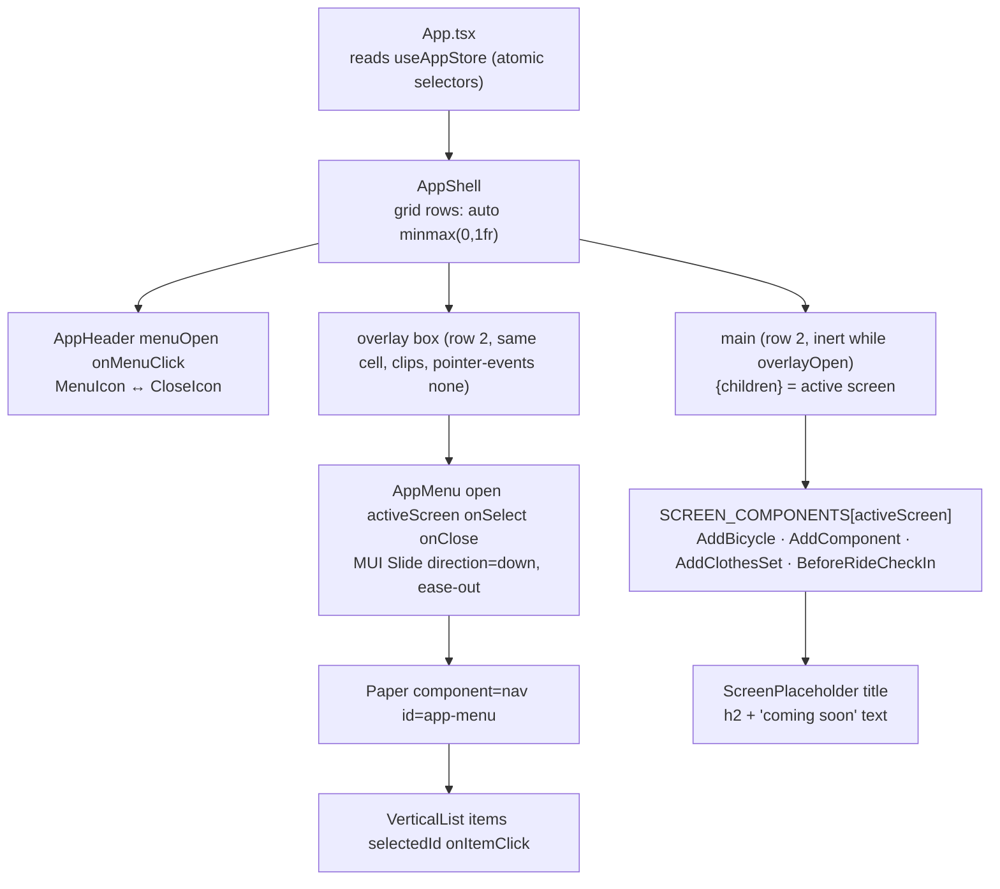

# Design: App menu screen

> **Status:** Implemented
> **Batch:** #6 (tickets #10 store · #11 vertical list · #12 header toggle · #13 placeholders · #14 menu screen ·
> #15 wiring; plan and ticket files removed after completion)
> **Builds on:** [app-shell-and-theme.md](./app-shell-and-theme.md)
> **Last updated:** 2026-11-21

## 1. Goal

Give the header menu button a purpose:

- Clicking the menu button opens a **menu screen** inside the `AppShell`, covering the main viewport (row 2) while the
  header (row 1) stays visible.
- The menu **slides down from the top** on open and **slides back up to the top** on close, with an `ease-out` curve.
- While the menu is open the menu button shows an **`X` (close) icon**; clicking it closes the menu.
- The menu lists four options, top to bottom: **Add bicycle**, **Add component**, **Add clothes set**,
  **Before ride check-in**.
- The list is a new **reusable `VerticalList`** component, so later screens can reuse it.
- Choosing an option closes the menu and shows that option's **placeholder screen** in `<main>`.

## 2. Wireframes

### 2.1 Mobile portrait (`xs`), menu closed (unchanged from the shell design)

```text
┌────────────────────────────────────┐
│ ≡  Bicam                           │  header (row 1)
├────────────────────────────────────┤
│                                    │
│  active screen (empty on start,    │  <main> (row 2)
│  or a placeholder screen)          │
│                                    │
└────────────────────────────────────┘
```

### 2.2 Mobile portrait (`xs`), menu open

```text
┌────────────────────────────────────┐
│ ✕  Bicam                           │  header stays put; icon is now X, label "Close menu"
├────────────────────────────────────┤ ─┐
│  Add bicycle                     │ │  │ <nav aria-label="Main menu" id="app-menu">
├──────────────────────────────────┤ │  │   Paper, square, fills row 2
│  Add component                   │ │  │   VerticalList → MUI List of ListItemButtons
├──────────────────────────────────┤ │  │   (48px+ rows, dividers between items)
│  Add clothes set                 │ │  │
├──────────────────────────────────┤ │  │ overflow-y: auto (scrolls if it ever outgrows row 2)
│  Before ride check-in            │ │  │
│                                    │  │ <main> is underneath and `inert`
└────────────────────────────────────┘ ─┘
```

### 2.3 Animation

```text
 open (enter)                               close (exit)
 t=0           t=225ms                      t=0           t=195ms
 ┌──header──┐  ┌──header──┐                 ┌──header──┐  ┌──header──┐
 ├──────────┤  ├──────────┤                 ├──────────┤  ├──────────┤
 │ (menu is │  │ menu     │                 │ menu     │  │ (menu is │
 │  above,  │→ │ fully    │                 │ fully    │→ │  above,  │
 │ clipped) │  │ visible  │                 │ visible  │  │ clipped) │
 └──────────┘  └──────────┘                 └──────────┘  └──────────┘
 translateY(-100%) → none                   none → translateY(-100%)
```

The menu never paints over the header: it slides inside a row-2 overlay box that clips its overflow, so it appears to
come out from under the header's bottom edge.

### 2.4 Structure



## 3. State (`src/store/`)

There is shared state now: the header, the menu, and `<main>` all depend on whether the menu is open and which screen
is active. Per `CLAUDE.md`, Zustand is the integration boundary, so this state lives in the single global store that
the `storybook-expert` skill already names: `useAppStore` in `src/store/useAppStore.ts`, with types in
`src/store/types.ts`.

| Field / action | Type | Behavior |
| --- | --- | --- |
| `isMenuOpen` | `boolean` | Default `false`. |
| `activeScreen` | `ScreenView` = `'home' \| 'addBicycle' \| 'addComponent' \| 'addClothesSet' \| 'beforeRideCheckIn'` | Default `'home'` (the empty main viewport). |
| `openMenu()` | action | Sets `isMenuOpen: true`. |
| `closeMenu()` | action | Sets `isMenuOpen: false`. |
| `toggleMenu()` | action | Flips `isMenuOpen`. Used by the header button. |
| `navigateTo(screen)` | action | Sets `activeScreen: screen` **and** `isMenuOpen: false` in one update, so choosing an option never leaves the menu open. |
| `reset()` | action | Restores the defaults above (the React skill requires a `reset` on every store). |

- No `persist` middleware: reopening the app starts on `home` with the menu closed. No `immer`: the state is flat.
- The default values live in `src/store/constants.ts` (`INITIAL_APP_STATE`) so `reset()`, tests, and story decorators
  share one baseline.
- There is no router. `activeScreen` is the only navigation state until the app needs URLs.

## 4. Components

### 4.1 `VerticalList` (`src/ui/components/VerticalList/`) — reusable

A thin wrapper over MUI `List` that renders items stacked vertically, each as a full-width button.

| Prop | Type | Notes |
| --- | --- | --- |
| `items` | `readonly VerticalListItem[]` (`{ id: string; label: string }`) | Rendered in order. `id` is the React key and the value passed to `onItemClick`. |
| `onItemClick` | `(id: string) => void` | Called with the clicked item's `id`. Enter/Space work because each row is a real `<button>` (`ListItemButton`). |
| `selectedId` | `string` (optional) | The matching row gets MUI `selected` styling **and** `aria-current="page"`, so the state is not shown by color alone. Typed as plain `string` so callers can pass a value that matches no row (the menu passes `home`). |
| `aria-label` | `string` (optional) | Passed to the `<ul>` for screen readers. |
| `dense`, `divided` | `boolean` (optional) | `divided` adds a bottom divider to each row (used by the menu); `dense` is MUI's compact density. |

- Markup: `<ul>` → `<li>` (`ListItem disablePadding`) → `ListItemButton component="button"` (a native `<button>`,
  not MUI's default `<div role="button">`) → `ListItemText`. Rows keep the MUI 48px minimum height (WCAG 2.5.5 touch target).
- No icons, secondary text, or links yet. Add them as optional props when a screen needs them.

### 4.2 `CloseIcon` (`src/ui/components/icons/CloseIcon.tsx`)

Same approach as `MenuIcon`: `createSvgIcon`, inline 24 × 24 SVG, `currentColor`, decorative (`aria-hidden`). Path:
`M19 6.41 17.59 5 12 10.59 6.41 5 5 6.41 10.59 12 5 17.59 6.41 19 12 13.41 17.59 19 19 17.59 13.41 12z` (an `X` made of
two crossing bars). `@mui/icons-material` is still not added. (Since added for the bicycle card image: see
[bicycle-card-list.md](./bicycle-card-list.md) §6; `MenuIcon` and `CloseIcon` stay hand-made.)

### 4.3 `AppHeader` changes

| Prop | Change |
| --- | --- |
| `menuOpen?: boolean` | New, default `false`. Chooses the icon and the label. |
| `menuId?: string` | New. Set as `aria-controls`; `App` passes `APP_MENU_ID`, so the header does not import the menu's constants. Omitted → no `aria-controls`. |
| `onMenuClick?: () => void` | Unchanged. |

| State | Icon | `aria-label` | `aria-expanded` | `aria-controls` |
| --- | --- | --- | --- | --- |
| Closed | `MenuIcon` (≡) | `header.menuButton.label` = "Open menu" | `false` | `app-menu` |
| Open | `CloseIcon` (✕) | `header.menuButton.closeLabel` = "Close menu" | `true` | `app-menu` |

The icon swaps instantly (no cross-fade). The header stays presentational: it does not read the store.

### 4.4 `AppShell` changes — overlay slot

| Prop | Change |
| --- | --- |
| `overlay?: ReactNode` | New. Rendered in a box that occupies **the same grid cell as `<main>`** (row 2, column 1), stacked above it. |
| `overlayOpen?: boolean` | New, default `false`. While `true`, `<main>` gets the `inert` attribute, so it cannot be focused, clicked, or read by assistive tech behind the menu. |

Overlay box styles (`OVERLAY_SX`): `gridRow: 2`, `gridColumn: 1`, `position: relative`, `overflow: hidden` (clips the
sliding panel so it never covers the header), `minHeight: 0`, `zIndex: 1`, `pointerEvents: 'none'` (the empty box never
blocks clicks on `<main>`; the panel sets `pointerEvents: 'auto'`). `<main>` gets an explicit `gridRow: 2`,
`gridColumn: 1` so both children share the cell. The two-row template and every existing shell check stay the same.

### 4.5 `AppMenu` (`src/ui/components/AppMenu/`)

| Prop | Type | Notes |
| --- | --- | --- |
| `open` | `boolean` | Drives the transition. |
| `activeScreen` | `ScreenView` | Passed to `VerticalList` as `selectedId`. |
| `onSelect` | `(screen: MenuScreen) => void` | Called with the chosen option. |
| `onClose` | `() => void` | Called on <kbd>Escape</kbd> anywhere in the document while the menu is open (a `keydown` listener added only while `open`), so it also works when focus is on the header button. |

- Options come from `MENU_ITEMS` in `AppMenu/constants.ts`: an ordered array of `{ id: MenuScreen, labelKey }` where
  `MenuScreen = Exclude<ScreenView, 'home'>`. Labels are translated at render time.
- Panel: `Paper component="nav" square elevation={0}` with `id="app-menu"`, `aria-label={t('menu.label')}`,
  `height: '100%'`, `overflowY: 'auto'`, `pointerEvents: 'auto'`, `bgcolor: 'background.paper'`.
- Transition: MUI `Slide` with `direction="down"`, `in={open}`, `mountOnEnter`, `unmountOnExit`, `appear={false}`.
  - Enter: `theme.transitions.duration.enteringScreen` (225ms); exit: `leavingScreen` (195ms).
  - Easing for **both** directions: `theme.transitions.easing.easeOut` (`cubic-bezier(0.0, 0, 0.2, 1)`), the theme's
    ease-out curve. Using the theme token instead of the bare `ease-out` keyword keeps all motion in one place.
  - `container` is the overlay box, so the slide distance is the box's height (it starts right above the box's top
    edge, hidden by the box's clipping).
  - `prefers-reduced-motion: reduce` → `timeout={0}` (the menu appears and disappears without movement). Read with
    `useMediaQuery(..., { noSsr: true })` so the very first open already respects it.
  - Closed = unmounted, so menu items are never in the tab order or the accessibility tree when hidden.
- Focus: after the enter transition, focus moves to the first menu option, unless the user already moved focus
  elsewhere during the slide. On exit, if focus was inside the menu (or
  was dropped to `<body>` when the panel unmounted), it returns to the element that had focus when the menu opened
  (normally the menu button). No focus trap: the header button stays reachable to close the menu, and `<main>` is
  `inert`.

### 4.6 Placeholder screens (`src/ui/components/screens/`)

| Screen id | Component | Title key | Title (en) |
| --- | --- | --- | --- |
| `addBicycle` | `AddBicycle` | `screens.addBicycle.title` | Add bicycle |
| `addComponent` | `AddComponent` | `screens.addComponent.title` | Add component |
| `addClothesSet` | `AddClothesSet` | `screens.addClothesSet.title` | Add clothes set |
| `beforeRideCheckIn` | `BeforeRideCheckIn` | `screens.beforeRideCheckIn.title` | Before ride check-in |

- Each is a one-line component around a shared `ScreenPlaceholder` (`screens/ScreenPlaceholder/`) that renders a
  `Typography variant="h5" component="h2"` title and a `body1` `text.secondary` line, `screens.placeholder.body` =
  "This screen is coming soon." The `<h1>` stays the app title.
- `SCREEN_COMPONENTS` (`screens/constants.ts`) maps each `MenuScreen` to its component. `home` has no entry, so `<main>`
  stays empty on start, exactly as today (the visual baselines do not change).

### 4.7 `App` wiring

`App` is the only store consumer. It uses atomic selectors (`useAppStore((s) => s.isMenuOpen)` …) and passes
props down:

```tsx
<AppShell
  header={<AppHeader menuOpen={isMenuOpen} menuId={APP_MENU_ID} onMenuClick={toggleMenu} />}
  overlay={<AppMenu open={isMenuOpen} activeScreen={activeScreen} onSelect={navigateTo} onClose={closeMenu} />}
  overlayOpen={isMenuOpen}
>
  {ActiveScreen && <ActiveScreen />}
</AppShell>
```

## 5. Accessibility and i18n

- New keys (English file first): `header.menuButton.closeLabel`, `menu.label` ("Main menu"), `menu.items.addBicycle`,
  `menu.items.addComponent`, `menu.items.addClothesSet`, `menu.items.beforeRideCheckIn`, `screens.<id>.title` ×4,
  `screens.placeholder.body`.
- Landmarks while open: `banner`, `navigation` ("Main menu"), and `main` (inert). Exactly one `<h1>`.
- Disclosure pattern on the menu button: `aria-expanded` + `aria-controls="app-menu"`. The `aria-controls` target
  exists only while the menu is mounted; that is valid for a disclosure (the attribute is ignored when the id is
  missing).
- Keyboard: <kbd>Tab</kbd> from the menu button reaches the options; <kbd>Enter</kbd>/<kbd>Space</kbd> selects;
  <kbd>Escape</kbd> closes; focus returns to the menu button.
- The selected option shows MUI `selected` styling plus `aria-current="page"`.
- Contrast: menu text uses `text.primary` on `background.paper`, already AA in both schemes. Stories in this batch set
  `a11y: { test: 'error' }`.

## 6. Out of scope

- Real forms or data for the four screens (placeholders only). "Add bicycle" became a real form in batch #17, see
  [add-bicycle.md](./add-bicycle.md).
- A way back to `home` other than reloading (the first real screen will define that). "Add bicycle" returns there
  on Save and Cancel. (Since implemented for every screen: the header title is a link to `home`, see
  [app-shell-and-theme.md](./app-shell-and-theme.md) §3.)
- URL routing, deep links, and browser back-button support.
- Persisting the active screen or the menu state.
- A drawer from the side, swipe-to-close, or closing by clicking outside (the menu fills row 2, so there is no outside).
- Icons or secondary text in menu rows.

## 7. Verification

| Layer | Lane | What it proves |
| --- | --- | --- |
| Store | `npm run test:store` | Defaults, `toggleMenu`/`openMenu`/`closeMenu`, `navigateTo` sets the screen and closes the menu, `reset` |
| Components | `npm run test:react` | `VerticalList` order/click/selection; `CloseIcon` path; header icon/label/`aria-expanded` per state; `AppShell` overlay cell + `inert`; `AppMenu` mount/unmount, ease-out easing + durations, Escape, focus; placeholders' headings; `App` end-to-end flow with the real store |
| Stories | `npm run test:storybook` | Desktop + Mobile (`mobile1`) + Dark stories for `VerticalList`, `AppMenu`, placeholders, header open state, and the App menu flow, with play assertions and `a11y.test: 'error'` |
| Coverage | `npm run test:all:coverage` | New `src/ui/**` files meet 90/85/90/90; `src/store/**` meets the 90% branch threshold |
| E2E | `e2e/mobile/app.spec.ts`, `e2e/ui/layout.spec.ts` (CI / Docker) | Opening the menu shows the four options under the header and swaps the icon; choosing one shows its placeholder and closes the menu. The closed-state visual baselines stay unchanged. |
