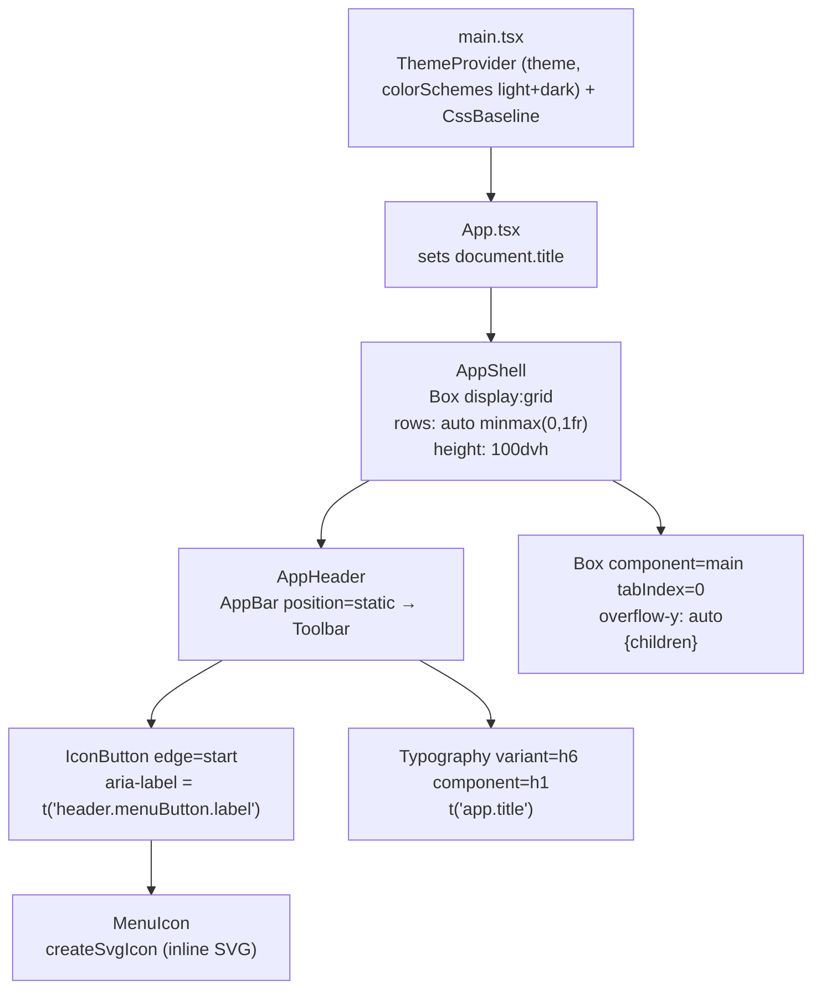

# Design: Application shell and theme

> **Status:** Implemented
> **Batch:** [tickets/plan.md](../../tickets/plan.md) (#4)
> **Tickets:** [#6 theme](../../tickets/6-light-dark-theme.md) · [#7 app shell](../../tickets/7-app-shell-layout.md) ·
> [#8 menu button](../../tickets/8-header-menu-button.md) · [#9 e2e alignment](../../tickets/9-e2e-app-shell-alignment.md)
> **Last updated:** 2026-11-21

## 1. Goal

Replace the centered "Bicam" splash with an app frame that later screens can be built in:

- A two-row grid that fills the viewport.
- Row 1 is a header pinned to the top. It does not scroll and holds a menu button and the `Bicam` title.
- Row 2 is the main viewport. It takes the remaining height and scrolls vertically.
- A shared MUI theme with light and dark color schemes that follows the OS preference.

The layout is mobile first: base styles target the smallest screen (`xs`), and larger breakpoints only add to them.

## 2. Wireframes

### 2.1 Mobile portrait (`xs`, the base layout)

Reference viewports: Storybook `mobile1` (320 × 568, the smallest and strictest case) and the e2e `web-mobile-portrait`
project (Pixel 7, 412 × 915). The drawing below is not to scale.

```text
┌────────────────────────────────────┐ ─┐
│ ┌────┐                             │  │ Row 1 — <header> AppBar (position: static)
│ │ ≡  │  Bicam                      │  │ height: 56px (MUI Toolbar, xs)
│ └────┘                             │  │ never scrolls
├────────────────────────────────────┤ ─┤
│                                    │  │ Row 2 — <main> viewport
│  ┌──────────────────────────────┐  │  │ height: 100dvh − header
│  │ content                      │  │  │ overflow-y: auto
│  └──────────────────────────────┘  │  │
│  ┌──────────────────────────────┐  │ ▲│
│  │ content                      │  │ █│ ◄ scrollbar belongs to <main>,
│  └──────────────────────────────┘  │ ▼│   not to <body>
│  ┌──────────────────────────────┐  │  │
│  │ content (overflows → scroll) │  │  │
└──┴──────────────────────────────┴──┘ ─┘
   ≡  = MenuIcon (inline SVG, 24px, currentColor) inside a 48 × 48 IconButton
```

### 2.2 Mobile landscape

Toolbar height in landscape depends on width. It is 48px only when the viewport is **under 600px wide** (for example
568 × 320). At 600px and wider the `sm` rule wins, so it is 64px. The e2e `web-mobile-landscape` project (915 × 412)
therefore gets **64px**. Tests must compare against the header's measured height, never a hard-coded value.

```text
┌──────────────────────────────────────────────────────────┐
│ ≡  Bicam                                                 │  48px if width < 600px, otherwise 64px
├──────────────────────────────────────────────────────────┤
│  content                                               ▲ │
│  content                                               █ │  main scrolls
│  content                                               ▼ │
└──────────────────────────────────────────────────────────┘
```

### 2.3 Tablet / desktop (`sm` and up, for example 1280 × 800 in Electron)

```text
┌──────────────────────────────────────────────────────────────────────────┐
│  ≡   Bicam                                                               │  64px (MUI Toolbar, sm+)
├──────────────────────────────────────────────────────────────────────────┤
│                                                                        ▲ │
│   ┌──────────────────────────────────────────────────────────────┐     █ │
│   │ content (padding grows with breakpoint: 2 → 3 spacing units) │       │
│   └──────────────────────────────────────────────────────────────┘       │
│                                                                        ▼ │
└──────────────────────────────────────────────────────────────────────────┘
```

### 2.4 Structure



## 3. Layout specification

| Element | Implementation | Key styles | Notes |
| --- | --- | --- | --- |
| Shell | `Box` (`src/ui/components/AppShell`) | `display: grid`, `gridTemplateRows: 'auto minmax(0, 1fr)'`, `height: 100vh` overridden by `100dvh` where supported, `overflow: hidden` | `minmax(0, 1fr)` lets row 2 shrink below its content height, so the overflow scrolls inside `<main>` instead of stretching the page. `dvh` follows the mobile browser chrome as it shows and hides. |
| Header row | MUI `AppBar` `component="header"` `position="static"` + `Toolbar` | Toolbar min-height comes from the theme mixins: 56px by default, 48px in landscape under 600px wide, 64px at 600px wide and up (the `sm` rule wins over landscape) | Not `position="fixed"`: the grid row already pins it, so no offset spacer is needed and `<main>` content never slides under it. |
| Menu button | `IconButton` `edge="start"` `color="inherit"` `size="large"` | 48 × 48 hit area | Meets WCAG 2.5.5 touch target size. Clicking does nothing in this batch (see §7). |
| Title | `Typography` `variant="h6"` `component="h1"` `noWrap` | Inherits the AppBar text color | Stays the page's only `<h1>`, so existing heading queries keep working. |
| Main viewport | `Box` `component="main"` `tabIndex={0}` | `overflowY: 'auto'`, `overscrollBehaviorY: 'contain'`, `minHeight: 0`, `p: { xs: 2, sm: 3 }`, a visible `:focus-visible` outline | The only vertical scroll container. `overscroll-behavior` stops scroll chaining and pull-to-refresh bounce from moving the header. `tabIndex={0}` lets keyboard users scroll it even when it has no focusable content (axe rule `scrollable-region-focusable`). |

**Lint note:** the repo has no `jsx-a11y` ESLint rules today. If one such as `jsx-a11y/no-noninteractive-tabindex` is
added later and flags `tabIndex={0}` on `<main>`, use a line-level disable comment that cites the reason above.

`#root` and `<body>` need no height rules: the shell `Box` sets its own height, and `CssBaseline` removes the body margin.

### Why CSS grid via `Box`, not the MUI `Grid` component

The MUI `Grid` component is a 12-column flexbox grid for laying out columns. It cannot express "one auto-height row plus
one row that takes the remaining height" without workarounds. The shell therefore uses the MUI System CSS Grid
properties (`display`, `gridTemplateRows`) on `Box` through `sx`, which MUI documents for this kind of page layout. The
`Grid` component is still the right tool for column layouts inside `<main>` on later screens.

## 4. Theme specification (`src/ui/theme/index.ts`)

### 4.1 Configuration

| Setting | Value | Reason |
| --- | --- | --- |
| `cssVariables` | `{ colorSchemeSelector: 'class' }` | Colors become CSS variables, so a scheme switch updates styles without regenerating Emotion styles. Components that call `useColorScheme` still re-render. The class selector lets Storybook and tests force a scheme (`useColorScheme().setMode`). A `media` selector would only ever follow the OS. MUI's storage manager (on by default for any CSS-variables theme with color schemes) saves the mode to `localStorage` once `setMode` is called, so anything that calls `setMode` must be able to reset it to `system`. |
| `colorSchemes` | `light` and `dark`, each with its own palette (§4.2) | The requirement says the app must work in both light and dark mode. |
| Default mode | `system` (the ThemeProvider default when both schemes exist) | Follows `prefers-color-scheme` and keeps the existing e2e test "follows the system dark color scheme" passing. |
| `breakpoints` | MUI defaults (`xs 0`, `sm 600`, `md 900`, `lg 1200`, `xl 1536`) | Write styles mobile first: put the base value in `xs`, override upward. |
| `shape.borderRadius` | `8` | Slightly softer than the MUI default (4). |
| `typography` | MUI default (`"Roboto", "Helvetica", "Arial", sans-serif`; Roboto is not bundled, so Helvetica/Arial render) | No web fonts. The CSP `font-src 'self' data:` blocks CDNs. |
| `components.MuiAppBar.defaultProps` | `{ color: 'primary', elevation: 0 }` + a 1px `divider` bottom border via `styleOverrides` | A flat header that reads well in both schemes. `color: 'primary'` is stated explicitly because the header's children (`IconButton color="inherit"`, the title) take their color from it. |

### 4.2 Palette (proposal, see the open questions in [plan.md](../../tickets/plan.md))

This table is the single source of truth for color values. Tickets refer to these tokens instead of repeating hex
codes, so changing the palette means editing this table only.

The contrast figures below are hand-calculated approximations used to choose the colors. The Storybook a11y gate
(`a11y.test: 'error'` on the new stories) is what confirms them.

| Token | Light | Dark | Contrast (approx.) |
| --- | --- | --- | --- |
| `primary.main` | `#00695C` (teal 800) | `#4DB6AC` (teal 300) | White on light ≈ 7:1; black on dark ≈ 8.8:1 |
| `secondary.main` | `#BF360C` (deep orange 900) | `#FFB74D` (orange 300) | White on light ≈ 5.5:1; black on dark ≥ 10:1 |
| `background.default` | `#F5F7F7` | `#0F1414` | Body text uses the MUI default `text.primary`, which passes AA in both schemes |
| `background.paper` | `#FFFFFF` | `#161D1D` | — |
| AppBar (`color="primary"`) | `primary.main` background, `primary.contrastText` (white) text | MUI dark default (`enableColorOnDark` off): dark `background.paper` background (`#161D1D`), `text.primary` text | A bright primary-colored bar is too loud in dark mode. Because the bar has the same color as `background.paper`, the 1px `divider` bottom border is what separates it from `<main>` (which shows `background.default`). MUI wires this through `palette.AppBar.darkBg`, which is a CSS-variable reference, so tests compare against the literal token value instead. The computed color is checked in the `AppShell` `Dark` story (#7); #6 only sets the theme defaults. |

All foreground/background pairs must meet WCAG AA (4.5:1 for body text, 3:1 for large text and icons). The repo-wide
Storybook a11y setting is `test: 'todo'` (warn only), so stories added in this batch set
`parameters: { a11y: { test: 'error' } }`. That makes contrast and landmark violations fail `npm run test:storybook`.

## 5. Menu icon

- File: `src/ui/components/icons/MenuIcon.tsx`, built with `createSvgIcon` from `@mui/material/utils`.
- An inline `<svg viewBox="0 0 24 24">` path of three 18 × 2 bars (`M3 6h18v2H3zm0 5h18v2H3zm0 5h18v2H3z`).
- Fill is `currentColor`, so the icon picks up the AppBar text color in both schemes. Size is in `em` (`fontSize`
  `small | medium | large` or an `sx` value), so it scales with CSS and stays crisp at any DPI.
- Decorative: `SvgIcon` sets `aria-hidden`. The accessible name comes from the `IconButton`'s `aria-label`.
- No new dependency: `@mui/icons-material` is **not** added just for one icon.
- Allowed by the current CSP, because an inline SVG is DOM rather than an `img-src` request.

## 6. Accessibility and i18n

- Landmarks: `<header>` (banner) and `<main>` (main). There is exactly one `<h1>`.
- The menu button has a translated `aria-label` (`header.menuButton.label` = "Open menu"). `aria-controls` and
  `aria-expanded` are added when a navigation drawer exists.
- Keyboard: the menu button is the first focusable element. The focus ring comes from MUI.
- Keyboard users can scroll `<main>`: it has `tabIndex={0}` and a visible focus outline, and it is the second tab stop
  after the menu button.
- New translation keys go into `src/i18n/locales/en/translation.json` first (type-checked via `i18next.d.ts`).

## 7. Out of scope

- What the menu button does (drawer, navigation, routing). It renders and is accessible, but clicking it does nothing yet.
- A manual light/dark toggle and storing the user's choice. The app follows the OS only.
- Zustand state. There is no shared state until the menu has behavior.
- Safe-area insets (`viewport-fit=cover`) for notched devices.
- Content for the main viewport beyond placeholder and story fixtures.

## 8. Verification

| Layer | Lane | What it proves |
| --- | --- | --- |
| Theme | `npm run test:react` | Both color schemes are defined, and the palette tokens match the literal §4.2 hex values (not imported constants) |
| AppShell / AppHeader / MenuIcon | `npm run test:react` | Landmarks, the h1, the menu button's accessible name, the scroll container's styles |
| Stories | `npm run test:storybook` | Desktop + Mobile (`mobile1`) + Dark stories render and pass play assertions; a11y violations fail (`a11y.test: 'error'` on the new stories) |
| Coverage | `npm run test:all:coverage` | New `src/ui/**` files meet the 90/85/90/90 thresholds in `vitest.config.ts` |
| E2E, Electron (`e2e/ui/layout.spec.ts`) | `npm run test:e2e:docker:electron` (CI on the batch → master PR) | The header is at the top and full width; `<main>` fills the rest and scrolls while the header stays put; dark mode follows the OS |
| E2E, web (`e2e/mobile/app.spec.ts`) | `npm run test:e2e:docker:web` | The same header/scroll checks in portrait (412 × 915) and landscape (915 × 412) |
| Visual (`e2e/visual/app.spec.ts`) | `npm run test:e2e:docker:update-snapshots` | The existing light and dark baselines are regenerated for the shell (Electron only; there are no web snapshots) |
