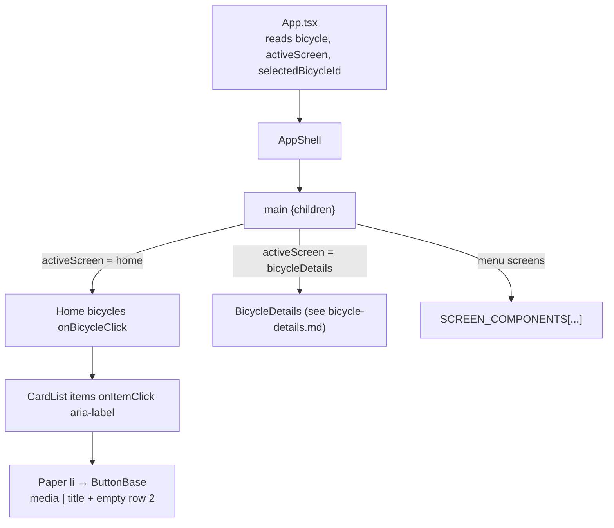

# Design: Bicycle card list

> **Status:** Implemented (event icons deferred, §8.1)
> **Batch:** #10 (tickets #19 card list on home · #20 selected bicycle in the store · #21 details placeholder;
> plan and ticket files removed after completion)
> **Builds on:** [app-shell-and-theme.md](./app-shell-and-theme.md), [app-menu.md](./app-menu.md),
> [docs/store/bicycle.md](../store/bicycle.md)
> **Superseded in part:** the details placeholder is now a real screen, see [bicycle-details.md](./bicycle-details.md)
> **Last updated:** 2026-11-25

## 1. Goal

Show the user's bicycles on the start screen (`home`) as a vertical stack of cards:

- A new **reusable `CardList`** component renders cards stacked vertically, each wrapped in an MUI `Paper`.
- Each card has an **image on the left** and **two rows of content on the right**: the bicycle **name** (row 1) and
  **event icons** (row 2). This batch builds the two-row layout and leaves row 2 empty; the icons need the `events`
  slice and are deferred (§8.1).
- The image is the `DirectionsBike` icon from `@mui/icons-material` for now (a new dependency, see §6).
- The whole card is **clickable** and opens the **Bicycle details** screen for that bicycle (a placeholder in this batch).

## 2. Wireframes

### 2.1 Mobile portrait (`xs`, `mobile1` 320 × 568), home with bicycles

```text
┌────────────────────────────────────┐
│ ≡  Bicam                           │  header (row 1), unchanged
├────────────────────────────────────┤
│ ┌────────────────────────────────┐ │ ─┐ <ul aria-label="Bicycles"> (Stack, spacing 1.5 = 12px)
│ │ ┌──────┐                       │ │  │
│ │ │  🚲  │  Gravel Grinder       │ │  │ <li> Paper elevation 1, radius 8
│ │ │      │  (event icons, later) │ │  │   └ <button> ButtonBase, full width, p 2 (16px)
│ │ └──────┘                       │ │  │     media 56 × 56 | text column
│ └────────────────────────────────┘ │  │
│ ┌────────────────────────────────┐ │  │
│ │ ┌──────┐                       │ │  │
│ │ │  🚲  │  Commuter with a very…│ │  │ long names truncate with an ellipsis (one line)
│ │ │      │                       │ │  │ row 2 is empty but keeps its 24px height
│ │ └──────┘                       │ │  │
│ └────────────────────────────────┘ │ ─┘
│                                    │  <main> scrolls when the list is taller than the viewport
└────────────────────────────────────┘
```

### 2.2 Card anatomy

```text
 ┌─ Paper (component="li") ───────────────────────────────────────────┐
 │ ┌─ ButtonBase (component="button", width 100%, p 2, gap 2) ──────┐ │
 │ │ ┌─ Avatar rounded ─┐  ┌─ text column (minWidth 0, flex 1) ──┐  │ │
 │ │ │  56 × 56         │  │ row 1: name   subtitle1, noWrap     │  │ │
 │ │ │  bg primary.main │  │ row 2: empty, minHeight 24          │  │ │
 │ │ │  DirectionsBike  │  │        (event icons, §8.1)          │  │ │
 │ │ └──────────────────┘  └─────────────────────────────────────┘  │ │
 │ └────────────────────────────────────────────────────────────────┘ │
 └────────────────────────────────────────────────────────────────────┘
```

Row 1 (`subtitle1`, 28px line) + row 2 (24px) = 52px, which fits next to the 56px image, so the card height will not
change when event icons are added.

### 2.3 Desktop (`sm`+, Electron 1280 × 800)

```text
┌──────────────────────────────────────────────────────────────────────────┐
│  ≡   Bicam                                                               │
├──────────────────────────────────────────────────────────────────────────┤
│   ┌──────────────────────────────────────────────────────────────────┐   │
│   │ [🚲]  Gravel Grinder                                             │   │  cards span the
│   │                                                                  │   │  content width
│   └──────────────────────────────────────────────────────────────────┘   │  (no max width yet)
│   ┌──────────────────────────────────────────────────────────────────┐   │
│   │ [🚲]  Roadie                                                     │   │
│   └──────────────────────────────────────────────────────────────────┘   │
└──────────────────────────────────────────────────────────────────────────┘
```

### 2.4 Bicycle details placeholder (after clicking a card)

Since replaced by the real screen: see [bicycle-details.md](./bicycle-details.md).

```text
┌────────────────────────────────────┐
│ ≡  Bicam                           │
├────────────────────────────────────┤
│  Gravel Grinder                    │  <h2>  = the bicycle's name (wraps, never overflows)
│  This screen is coming soon.       │  body1, text.secondary (shared ScreenPlaceholder)
│                                    │
└────────────────────────────────────┘
```

### 2.5 Structure



## 3. State (`src/store/`) — ticket #20

Navigation stays a plain `activeScreen` value (no router). The details screen also needs to know **which** bicycle to
show, so the store gets one more UI field.

| Field / action | Type | Behavior |
| --- | --- | --- |
| `ScreenView` | `'home' \| 'addBicycle' \| 'addComponent' \| 'addClothesSet' \| 'beforeRideCheckIn' \| 'bicycleDetails'` | Still a literal union; adds `'bicycleDetails'`. |
| `MenuScreen` | `Exclude<ScreenView, 'home' \| 'bicycleDetails'>` | Same four menu screens as before; `bicycleDetails` is not a menu option. |
| `selectedBicycleId` | `BicycleId \| null` | UI state at the root, initial `null`. Set only together with `activeScreen: 'bicycleDetails'`. |
| `openBicycleDetails(id)` | `(id: BicycleId) => boolean` | If `hasBicycle(id)`: sets `activeScreen: 'bicycleDetails'`, `selectedBicycleId: id`, `isMenuOpen: false` in one update and returns `true`. Unknown id: returns `false`, state unchanged. |
| `navigateTo(screen)` | `(screen: Exclude<ScreenView, 'bicycleDetails'>) => void` | Now also sets `selectedBicycleId: null`. The parameter type excludes `'bicycleDetails'`, so details can only be opened with an id. |
| `removeBicycle(id)` | existing signature | **Wrapped in `useAppStore.ts`**, not changed in the bicycle slice: the wrapper calls the slice's `removeBicycle`; if it returned `true` and `id === selectedBicycleId`, it then sets `selectedBicycleId: null` and `activeScreen: 'home'`. The bicycle slice keeps writing only `bicycle`. |
| `reset()` | existing | `INITIAL_APP_STATE` gains `selectedBicycleId: null`. |

Invariant: after each action completes, `activeScreen === 'bicycleDetails'` ⇔ `selectedBicycleId` is a stored bicycle id.

- **Why wrap `removeBicycle` instead of changing the slice:** each slice owns its own keys; the UI fields belong to the
  root store (`useAppStore.ts`). The wrapper is the one place where domain and navigation state meet. Recorded in
  [docs/store/README.md](../store/README.md) §5 (Decisions).
- **Two `set` calls:** the wrapper updates `bicycle` first, then the UI fields, both synchronously inside one action.
  React batches them into one render, so the UI never shows the in-between state. A non-React subscriber could see it
  for one notification; `App`'s guard (§4.5) also covers that case.
- `selectedBicycleId` is UI state and is excluded from persistence by `partialize`, like `isMenuOpen` and
  `activeScreen`.

## 4. Components

### 4.1 `CardList` (`src/ui/components/CardList/`) — reusable

Domain-agnostic: it knows nothing about bicycles. Callers map their data to items.

```ts
interface CardListItem<Id extends string = string> {
  id: Id;           // React key and value passed to onItemClick
  title: string;    // row 1; already translated or user text; the card button's accessible name
  media: ReactNode; // left image; decorative; phrasing elements only (it renders inside a <button>)
}

interface CardListProps<Id extends string = string> {
  items: readonly CardListItem<Id>[];
  onItemClick: (id: Id) => void;   // click, Enter, or Space
  'aria-label'?: string;
}
```

No `icons` field yet: declaring it before anything renders it would be dead code (and `npm run quality:unused` may
flag it). The event-icons work adds it (§8.1).

| Part | Implementation | Key styles |
| --- | --- | --- |
| List | `Stack component="ul"` | `spacing: 1.5`, `listStyle: 'none'`, `m: 0`, `p: 0` (vertical stack; `<main>` already pads and scrolls) |
| Card | `Paper component="li" elevation={1}` | `overflow: 'hidden'` so the button's ripple and focus ring follow the 8px radius |
| Click target | `ButtonBase component="button" type="button"` | `width: '100%'`, `display: 'flex'`, `alignItems: 'center'`, `justifyContent: 'flex-start'`, `gap: 2`, `p: 2`, `textAlign: 'left'`, `borderRadius: 'inherit'`, visible `:focus-visible` outline (`2px solid` `primary.main`, `outlineOffset: -2px`) that follows the rounded corners |
| Media slot | `Box component="span"` wrapping `media` | `flexShrink: 0`, `aria-hidden` |
| Text column | `Box component="span"` | `minWidth: 0`, `flex: 1`, `display: 'flex'`, `flexDirection: 'column'` |
| Row 1 | `Typography variant="subtitle1" component="span" noWrap` | Ellipsis for long names; the full name stays the accessible name |
| Row 2 | `Box component="span"` | `minHeight: 24`; empty until event icons are added (§8.1) |

- Everything inside the button is a `<span>` (including the avatar), because a `<button>` may only contain phrasing
  content.
- Enter/Space work because the click target is a native `<button>`. The card is ≥ 88px tall, well above the 44px touch
  target.
- Empty `items` renders an empty `<ul>`; whether to render the list at all is the caller's choice (see §4.3).

### 4.2 `BicycleAvatar` media

The left image for a bicycle card: `Avatar component="span" variant="rounded"` 56 × 56, `bgcolor: 'primary.main'`,
`color: 'primary.contrastText'`, containing `DirectionsBike` (`fontSize: 32`). Decorative (inside the `aria-hidden`
media slot). It lives next to the `Home` screen (`screens/Home/BicycleAvatar.tsx`) because only bicycle cards use it.

Contrast (graphics need 3:1): light uses white on `#00695C` (≈ 7:1, the same pair as the light AppBar). Dark uses
`primary.contrastText` on `#4DB6AC`; MUI picks black there (≈ 8.8:1), but the dark AppBar does **not** use this pair
(it uses `background.paper`), so the Dark story's a11y check is what confirms it.

When real bicycle photos exist, this becomes `Avatar src=…` with the icon as the fallback child.

### 4.3 `Home` screen (`src/ui/components/screens/Home/`)

| Prop | Type | Notes |
| --- | --- | --- |
| `bicycles` | `readonly Bicycle[]` | In display order (`allIds`). Type-only import from `@store/bicycle/types`. |
| `onBicycleClick` | `(id: BicycleId) => void` | Passed to `CardList` as `onItemClick`. |

- Maps each bicycle to `{ id, title: bicycle.name, media: <BicycleAvatar /> }` and renders
  `<CardList aria-label={t('home.bicycleList.label')} … />`.
- **No bicycles → renders `null`**, so `<main>` stays empty on a fresh start exactly as today and the e2e visual
  baselines do not change. An empty-state message is an open question (§8).
- `home` stays out of `SCREEN_COMPONENTS` because it needs props; `App` renders it directly.

### 4.4 `BicycleDetails` screen (`src/ui/components/screens/BicycleDetails/`)

Since replaced by the real screen: see [bicycle-details.md](./bicycle-details.md).

| Prop | Type | Notes |
| --- | --- | --- |
| `name` | `string` | The selected bicycle's name. |

Renders `<ScreenPlaceholder title={name} />`: the name as the `<h2>` and the shared "This screen is coming soon." line.
No new translation keys.

### 4.5 `App` wiring

```tsx
const bicycleCollection = useAppStore((s) => s.bicycle);           // stable reference until it changes
const selectedBicycleId = useAppStore((s) => s.selectedBicycleId);
const openBicycleDetails = useAppStore((s) => s.openBicycleDetails);

const bicycles = useMemo(
  () => bicycleCollection.allIds.map((id) => bicycleCollection.byId[id]),
  [bicycleCollection],
);
// The props of BicycleDetails are in bicycle-details.md.
// The selection may briefly point at a removed bicycle, so the details screen is only rendered when it resolves.
const selectedBicycle = selectedBicycleId === null ? undefined : bicycleCollection.byId[selectedBicycleId];

const isMenuScreen = activeScreen !== 'home' && activeScreen !== 'bicycleDetails';
const ActiveScreen = isMenuScreen ? SCREEN_COMPONENTS[activeScreen] : null;

// inside <AppShell>:
{ActiveScreen && <ActiveScreen />}
{activeScreen === 'home' && <Home bicycles={bicycles} onBicycleClick={openBicycleDetails} />}
{activeScreen === 'bicycleDetails' && selectedBicycle && <BicycleDetails bicycle={selectedBicycle} … />}
```

Selecting the whole `bicycle` slice and mapping it in `useMemo` follows the store rule in
[docs/store/README.md](../store/README.md) §2 (no selector that builds a new array on every call).

## 5. Accessibility and i18n

- New key (English file first): `home.bicycleList.label` = "Bicycles" (#19).
- List semantics: `<ul aria-label="Bicycles">` → `<li>` per card, so screen readers announce "list, N items".
- Each card is one `<button>` whose accessible name is the bicycle name.
- Focus ring: visible `:focus-visible` outline on the button, inside the Paper's rounded corners.
- After opening details, focus is not moved (the clicked card unmounts; focus falls to `<body>`, then <kbd>Tab</kbd>
  reaches the menu button). Moving focus to the details `<h2>` is a follow-up if needed.
- Contrast: the name uses `text.primary` on `background.paper`. Stories set `a11y: { test: 'error' }`.

## 6. Dependency: `@mui/icons-material`

- Earlier designs deliberately did not add it (one hand-made icon each for `MenuIcon` / `CloseIcon`). This batch adds it
  because the requirement names `@mui/icons-material/DirectionsBike`, and the deferred event icons will need more.
- Install the version matching the `@mui/material` major (`^9`, currently `^9.5.0`) as a runtime `dependency`.
- Import each icon by its path (`import DirectionsBikeIcon from '@mui/icons-material/DirectionsBike'`), never from the
  package root, so dev-server startup and the bundle stay small. The one exception is a **type-only** import
  (`import type { SvgIconComponent } from '@mui/icons-material'`), which is erased at build time and costs nothing.
- Icons are inline SVG, so the CSP is unaffected.
- `MenuIcon` and `CloseIcon` stay as they are; replacing them is out of scope.

## 7. Out of scope

- Event icons on row 2 (deferred, §8.1) and the `events` slice itself.
- Adding, editing, or deleting bicycles from the UI. Adding came later, in batch #17: see
  [add-bicycle.md](./add-bicycle.md).
- Real bicycle photos, sorting, filtering, search, or a max content width on desktop.
- A back button or any way back to `home` from details other than the existing menu flow (an open item from
  [app-menu.md](./app-menu.md) §6). (Since implemented: the header title links to `home`.)
- URL routing, deep links, and persisting the selected bicycle.
- Swipe actions, long-press menus, or secondary actions on a card.

## 8. Open questions

| Question | Why it matters | Proposed answer |
| --- | --- | --- |
| Which event kinds get icons, and which events show on a card (upcoming, due, most recent)? | The `events` slice is a placeholder, so there is no data or type to map from. | Deferred to the batch that implements the `events` slice (§8.1). |
| Should `home` show an empty-state message when there are no bicycles? | Today `home` is blank; a message would change the e2e visual baselines. | Not in this batch: render nothing. Add an empty state with a call to action when "Add bicycle" becomes a real form. |
| How does the user get back to `home` from details? | Without it, details is a dead end apart from reloading. | Out of scope here; decide when the menu gets a "Home"/"Bicycles" item or the header gets a back button. Since resolved: the header title links to `home`. |

### 8.1 Deferred: event icons on row 2

Moved out of this batch because it cannot be finished before the `events` slice exists. Notes for that batch:

- `CardListItem` gains `icons?: readonly CardListIcon[]`, with
  `CardListIcon = { id: string; Icon: SvgIconComponent; label: string }`.
- Row 2 becomes `Stack direction="row" spacing={1}` (`minHeight: 24`, `alignItems: 'center'`); icons `fontSize: 20`,
  `color: 'text.secondary'` (≥ 3:1 in both schemes), each with `titleAccess={label}` (`role="img"` + `<title>`).
- The card button gets `aria-labelledby` = the title's id and `aria-describedby` = the icon row's id (`useId()`), so
  its name stays the bicycle name and the events are read as its description.
- `Home` maps events through one `BicycleEventKind` → `{ Icon, labelKey }` map; labels `bicycleCard.events.<kind>`.
- Decide on overflow at 320px (clip or wrap) and assert it in a Mobile story.
- Open: the event kinds, their icons, and which events a card shows.

## 9. Verification

| Layer | Lane | What it proves |
| --- | --- | --- |
| Store (#20) | `npm run test:store` | `selectedBicycleId` default; `openBicycleDetails` for known/unknown ids; `navigateTo` clears the selection; removing the selected bicycle returns to `home`, removing another does not; `reset` |
| Components (#19, #21) | `npm run test:react` | `CardList` order, Paper per card, media + title + empty row 2, click/Enter/Space call `onItemClick`; `Home` maps bicycles and renders nothing when empty; `BicycleDetails` heading (placeholder at the time); `App` flow with the real store (seed → click card → details) |
| Stories | `npm run test:storybook` | Desktop, Mobile (`mobile1`), and Dark stories for `CardList`, `Home` (with long names and many items), `BicycleDetails`, and the App home → details flow, with play assertions and `a11y.test: 'error'`; no horizontal overflow at 320px |
| Coverage | `npm run test:all:coverage` | New `src/ui/**` files meet 90/85/90/90; `src/store/**` meets the 90% branch threshold |
| E2E | not changed | `home` is still empty without seeded data, so the existing layout and visual baselines stay valid |
